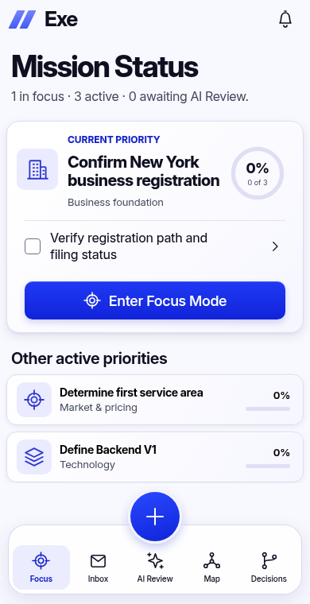

# Exe — coded design master

**Separate reference artifact, awaiting appearance approval. It has not been applied to the Exe application.**

Three standalone HTML screens, shared HTML partials, local Inter font, inline SVG icon primitives, reusable CSS, and explicit design tokens. The reference images are used only in the comparison documents, never as interface components or backgrounds.

| Reference screen | Coded HTML | Actual browser screenshot |
| --- | --- | --- |
| Mobile Focus — 390 × 760 | [HTML](mobile-focus.html) | [Screenshot](evidence/mobile-focus.png) |
| Mobile Inbox — 390 × 760 | [HTML](mobile-inbox.html) | [Screenshot](evidence/mobile-inbox.png) |
| Desktop Focus — 1280 × 840 | [HTML](desktop-focus.html) | [Screenshot](evidence/desktop-focus.png) |

The screenshots contain app content only: no device frames, clock/status bar, simulated address bar, home indicator or external decorative background. Viewport heights were chosen from the approved UI crop proportions, not from full device-image dimensions.

## Compare and inspect

- [Mobile Focus versus latest light-glass UI](evidence/comparisons/mobile-focus.png)
- [Mobile Inbox versus latest light-glass UI](evidence/comparisons/mobile-inbox.png)
- [Desktop Focus versus floating-capture UI](evidence/comparisons/desktop-focus.png)
- [Mobile Focus versus floating-capture layout](evidence/comparisons/floating-focus.png)
- [Component specification, calibration and remaining discrepancies](COMPONENT-SPEC.md)
- [Browser-measured x/y/width/height](MEASUREMENTS.md)
- [Full computed-style measurements](evidence/measurements.json)
- [Exact design tokens](tokens.css) · [Component CSS](master.css) · [Shared HTML partials](partials/)



## Reproduce

Serve the repository with a local static HTTP server; no application server, dependency installation, external runtime request or application script is needed. From the repository root:

```sh
python3 -m http.server 8000 --bind 127.0.0.1
```

Open the appropriate `design-master/*.html` file through that server at the viewport listed above. The font and icons are local. Generated HTML is committed and ready to render; only template edits require rebuilding:

```sh
cd design-master
python3 build.py
python3 verify.py
python3 compare.py
```

Evidence generation uses the environment's Python Playwright, Chromium and Pillow. `verify.py` waits for the local font, captures actual screens, writes measurements, checks zero initial completion, five navigation labels, touch targets and floating clearance, and asserts that no files outside `design-master/` changed from application commit `399359e`.

## Scope and interaction contract

This is a **visual master**, not a second application. Focus/Inbox links select reference pages; checkboxes and overflow disclosures use native HTML. Other action buttons, filters, capture and destination controls illustrate their exact rendered appearance but do not implement workflows. Inline Enter is suppressed to avoid accidentally submitting the reference document. There is no storage, authentication, live AI, priority engine, task mutation API, or backend in this directory. Native checkbox changes are temporary and not persisted.

The three Now priorities and all example wording come from the existing application. Initial structured progress is 0%; all 18 raw captures are unchecked; review completion is not inferred from a checklist check. The notification dot is absent because the existing example has zero pending AI reviews.

Only this directory is added by this assignment. Root application files, architecture and PR #1 merge state are untouched. Appearance approval is required before any subsequent application integration. No deployment or Phase 2 work.
