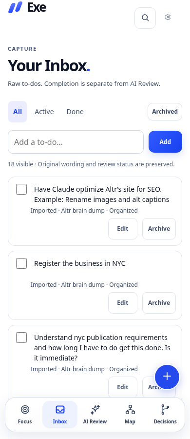
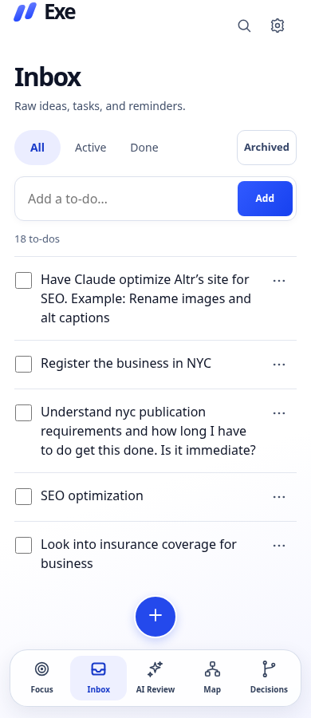
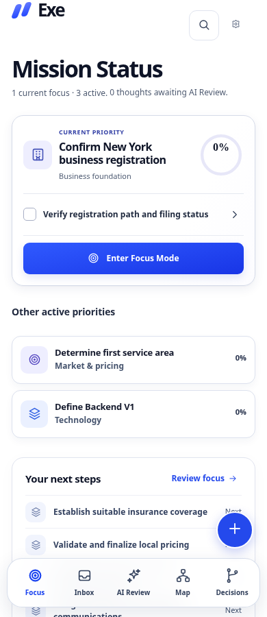
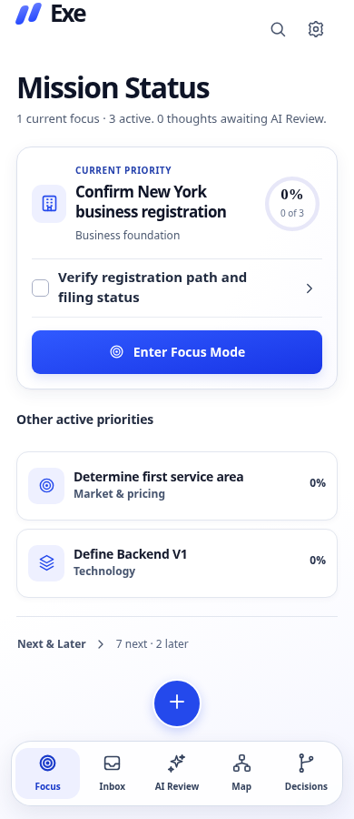

# Phase 1 refinement — acceptance review

The latest `main` was merged into `feat/phase-1-inbox-mobile-parity` without conflicts, preserving the initial Phase 1 implementation. Before editing the UI, both approved WebP images, their precedence README, AGENTS.md, and V1-LOCKED-SPEC.md were inspected. This review updates PR #1 only. No merge to main, deployment, backend, AI integration or Phase 2 work.

## Visual comparison with the approved references

| Approved source | Observed visual direction | Rendered implementation and deliberate differences |
| --- | --- | --- |
| [Floating capture and Inbox](../assets/design-reference/approved-floating-capture-and-inbox.webp) | Dominant current-priority card, compact Mission Status, two subordinate active rows, raw checklist with visible filters and inline entry, separate elevated cobalt capture | Same hierarchy and capture separation. Inbox uses divider rows with 16px task text and wrapped descriptions. All 18 original captures remain verbatim. Progress is the real **0%**, rather than the illustration’s 50/33/25%. The two other Now outcomes are correctly labeled **Other active priorities**, rather than the mobile mockup’s “Next priorities.” |
| [Light glass navigation](../assets/design-reference/approved-light-glass-navigation.webp) | White canvas, crisp dark type, hairline rows, quiet ellipsis actions, subtle glass edges, soft card depth | Actions and provenance are inside accessible row disclosures. Dock has 82% white, 18px blur, a 1px edge, restrained shadow and a near-opaque fallback. All **five labeled destinations** remain. Capture is centered *above* the dock, not substituted for its middle destination. A reserved bottom region prevents content from moving under either control. |

The mockups include device frames, browser chrome, illustrative data and inconsistent navigation. Comparison is visual and structural, not a claimed pixel-identical overlay. The written feature/data contracts take precedence. The prototype’s existing logo and system font stack remain; there is no external font dependency.

## Before / after — real rendered screenshots

These screenshots use a clean example, with no completed tasks or fictional progress. Mobile images use a 900px-high browser viewport; actual iPhone browser chrome is not simulated in the image itself.

| Screen | Before this refinement | After this refinement |
| --- | --- | --- |
| Desktop Focus, 1280px, full page | [Before](screenshots/refinement/before-1280-focus-full.png) | [After](screenshots/refinement/after-1280-focus-full.png) |
| Mobile Focus, 390px | [Before](screenshots/refinement/before-390-focus.png) | [After](screenshots/refinement/after-390-focus.png) |
| Mobile Inbox, 390px | [Before](screenshots/refinement/before-390-inbox.png) | [After](screenshots/refinement/after-390-inbox.png) |

Additional rendered Focus/Inbox screenshots are retained at 320, 375, 430 and 1440px in `screenshots/refinement/`.

### Mobile Inbox

| Before | After |
| --- | --- |
|  |  |

### Mobile Focus

| Before | After |
| --- | --- |
|  |  |

## Changes and preserved capabilities

- Replaced individual Inbox cards, always-visible metadata, and repeated action buttons with continuous checklist rows. Ellipsis buttons expose Edit, Archive/Restore, review state, timestamps and provenance. Disclosures have descriptive names, `aria-expanded`, `aria-controls`, keyboard activation, and Escape-to-close. Edited originals remain available. Add, check/uncheck, filters, persistence and AI/task independence are unchanged.
- Refined white surfaces, subtle edges, row alignment, readable typography and consistent cobalt. Kept red blocked signals and reduced-motion/focus-visible styles. Small-screen text is not reduced to increase density. Header utility icons use the same 20px geometry.
- Centered the separate 54px capture control above the five-destination glass dock. Mobile content scrolls within a region ending above the capture control, including at the end of long lists. This intentionally reserves some vertical space so controls never cover content. The last row and its expanded actions remain fully reachable.
- Subordinated Next/Later to a quiet entry into the existing priority-review dialog, with real lane counts. Removed the repeated Next list and duplicate page-local capture prompts. Next/Later management, Search, Settings, backups, Map, decisions, and focus checklists remain accessible.
- Matched the references’ Focus hierarchy and restrained card depth. Current progress, next actionable step and Focus Mode CTA remain prominent. On 320px the decorative hero icon is omitted to preserve readable title/progress sizing; no action or data is removed.
- Capture preserves the current route, unfinished Inbox draft, expanded rows/checklist, mobile scroll position, and Focus Mode scroll position. Keyboard focus returns to the current rendered Focus Mode trigger even after background content has rerendered.
- Modal sheets follow VisualViewport height/offset, and floating controls account for its keyboard inset. These changes are layout handling only; entities, seed state, priority logic and approval rules remain unchanged.

## Verification

See [test results](TEST-RESULTS.md) and [reproduction commands](PHASE-1.md). Existing regressions plus new acceptance tests cover all requested mobile sizes and desktop, compact/disclosed rows, long unbroken text, end-of-list hit targets, filters, editing, archive/restore, completion independence, project/decision actions, Focus Mode capture context, safe areas, reduced motion and reduced visual viewport geometry. Automated accessibility uses axe-core 4.14.0 with WCAG A/AA tags, including expanded rows, not just the uncluttered default view.

## Remaining acceptance limitations

- No physical iPhone Safari, actual software keyboard, dynamic browser-chrome or VoiceOver session was available. Safe-area and smaller/offset visual-viewport tests are emulation, not device acceptance. Portrait/landscape, hardware zoom and background/foreground retention still need a real-device check.
- Automated axe checks cover supported rules; they do not establish full WCAG conformance or screen-reader usability.
- No public deployment or cross-device validation was performed, as requested. This remains a local-storage prototype. No release or production-readiness claim is made.

Ready for visual review of Phase 1. No further phase is started.
