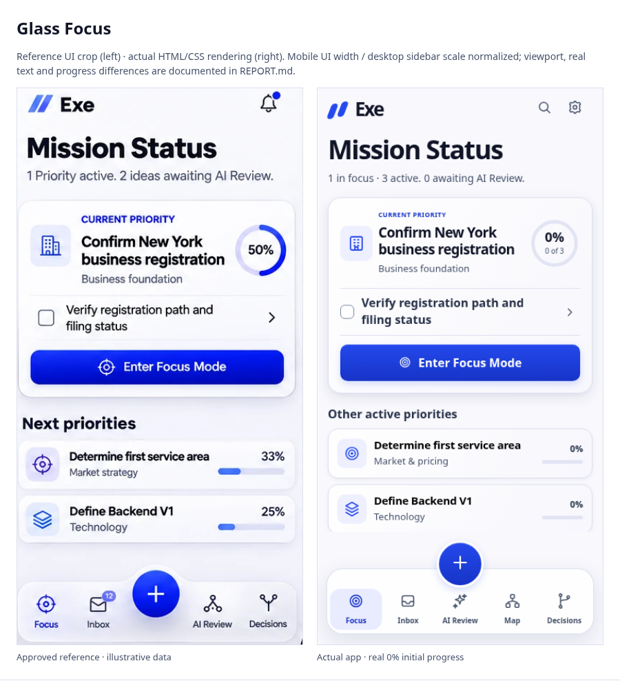

# Exe V1 — final visual conformance review

Scope: existing Phase 1 branch and PR #1. The two approved mockups were inspected as the visual target, and the locked specification as the behavioral target. [Pre-code discrepancy audit](AUDIT.md). No architecture, entities, priority logic, approval rules, seed completion, backend or AI changes. This report replaces the earlier “general direction” assessment with UI-only comparisons, measurements and two verification passes.

## A. Visual conformance results

| Design area | Reference target | Implemented result | Remaining difference / reason |
| --- | --- | --- | --- |
| Canvas and palette | Predominantly white, cool off-white, restrained cobalt | `#f8f8fd` canvas, white raised surfaces, `#f7f7fd` cool tint, `#2449ec` / `#1734c7` cobalt | Decorative image-generated waves are not copied. No reference bitmap is loaded by the app |
| Typography | Crisp sans, strong Mission Status/title hierarchy, readable slate | One system-sans stack, 36px desktop/normal mobile page heading, 30px at 320px; 26px desktop and 19px mobile current title; 16px raw checklist | Exact mockup font/vector sources are unavailable. Native font rasterization and icon silhouettes differ slightly; no serif fallback remains |
| Spacing and geometry | Disciplined gutters, compact header, clearly grouped cards | Shared 4/8/12/16/20/24/32/48 scale; 14px mobile inset; mobile brand centered in a 56px header | At 320px the authoritative title wraps to three lines; readable text is preserved rather than clipped |
| Surface definition | Cool elevated card, precise boundary, soft layered shadow | Shared 1px edge, 18px hero radius, 14px supporting radius, two-layer elevation tokens | Very subtle tint/antialiasing variations remain because the target is a perspective raster illustration |
| Mobile Focus | One dominant priority, ring, visible action step, cobalt CTA | Calibrated icon/title/ring header, 70px ring, separated actionable row, full-width 48px CTA | Actual initial progress stays **0% / 0 of 3**, not the reference’s fictional 50% |
| Other active priorities | Two subordinate cards, icon tiles, percentage and thin cobalt tracks | 68px mobile baseline rows, 15px titles/13px subtitles; explicit block tracks 56×5px, or 44×5px at 320px | Zero-percent tracks are intentionally empty. Text says **Other active priorities**, as required by the locked spec |
| Dock | Frosted floating capsule, thin edge, soft shadow, inner highlight | 82% white, 18px blur, saturation1.2, 1px glass edge, 22px radius, shared glass shadow; near-opaque fallback | 90px height rather than the drawn ~75–85px bar, to retain all five labeled 44px+ targets below capture |
| Capture assembly | Cobalt circle visually emerges from dock | 64px circle intersects dock top by 26px; all five 56px-high navigation targets begin 6px below circle bottom | This is the smallest shared vertical separation used to avoid covering the central AI Review destination; the mockups sometimes omit it |
| Floating clearance | Safe areas, no obscured task controls | Reserved scroll region ends 12px above capture; safe-area and keyboard inset are included in the shared geometry | Shorter screens scroll. Unlike the decorative illustration, content is clipped to a real clear scroll region rather than allowed behind controls |
| Inbox | Heading/subtitle, raw divider list, inline add, quiet ellipsis | Compact 16px rows, aligned custom checkboxes, hairline separators, accessible disclosures; subdued inline Add | Visible All/Active/Done and Archived access are retained even though the latest illustration omits filters. Long original captures wrap, so fewer rows fit than short fictional examples |
| Desktop Focus | Narrow dominant card, aligned secondary rows, compact heading, proportionate sidebar | 208px sidebar; card x240/y148, 500px column, 84px ring; title wraps as two strong lines; quiet Next/Later entry | Reference desktop is partly occluded by phones. 500px is a practical fit for the official title, native font and real checklist; it is ~7% wider than a sidebar-normalized estimate from the first image |
| Search/settings/capture | Preserve full desktop/mobile capability | Existing Search moved to lower sidebar; workspace/settings and backup controls retained; mobile Search/Settings remain in header | Header utilities replace the redundant illustrated bell because AI Review already has its required dock destination. Existing global desktop capture remains available |
| Other existing screens | Same components, not invented layouts | Shared fonts, text roles, borders, radii, controls and elevation on AI Review, Map, Decisions, Focus Mode, capture and settings | Their workflow structure and selection/drill-down composition are unchanged; neither mockup supplies complete layouts for them |
| Feedback/accessibility | Quiet hover/press, focus, disabled/error and semantic states | Shared focus ring, hover surfaces, pressed shading, disabled opacity, native required validation, reduced motion; genuine task blockers retain red icon+text | Axe is not a substitute for manual screen-reader/device acceptance. Checkbox boundaries also have a direct >=3:1 non-text contrast assertion |

The identified major/moderate implementation discrepancies have been corrected; the remaining functional, viewport and source-format differences are explicitly explained above. This is ready for user visual acceptance review, not a claim of pixel-perfect identity or full device compatibility.

## UI-only comparisons

The reference crops exclude laptop/phone frames, external backgrounds, status/browser chrome and home indicators as far as a rectangular crop permits. No camera perspective is added to actual screenshots. Mobile actual viewports use the reference UI aspect ratio; desktop is normalized by the visible sidebar width because the rest is partly occluded. No percentage-fidelity score or pixel-diff threshold is asserted: different real text/progress makes one misleading.

- [Latest glass Focus — reference versus actual](comparisons/glass-focus-comparison.png)
- [Latest glass Inbox — reference versus actual](comparisons/glass-inbox-comparison.png)
- [Floating-capture Focus — reference versus actual](comparisons/floating-focus-comparison.png)
- [Desktop visible UI — reference versus actual](comparisons/floating-desktop-comparison.png)

Crop coordinates and reproduction logic are in [visual_compare.py](../../tests/visual_compare.py). Original approved files remain unchanged in `assets/design-reference/`.

## Two verification passes

| Pass | Inspected artifacts | Findings and corrections |
| --- | --- | --- |
| 1 | [390 Focus](pass-1/390-focus.png), [390 Inbox](pass-1/390-inbox.png), [1280 Focus](pass-1/1280-focus.png), capture and other screens, [geometry](pass-1/geometry.json) | Restored tracks and sans numerals; integrated circle/dock. Found desktop column still too broad/low, legacy 390px gutter and brand alignment, and lighter checkbox boundaries. This prompted narrower/higher desktop composition, breakpoint cleanup and direct contrast checking |
| 2 | All six Focus/Inbox widths; four capture/dock sizes; UI-only comparisons; other screens and dialogs; [geometry](pass-2/geometry.json) | Corrected title/label scale, compact header, 375px icon allocation, quiet inline Add and shared shadows. Verified real progress, long-text density, clip clearance, complete dock/circle geometry and required destinations. Corrected saved-label text contrast and checkbox contrast. Final screenshots re-rendered after corrections |

Measured implementation changes (CSS pixels):

| Measurement | Before assignment | Final |
| --- | --- | --- |
| Desktop sidebar | 238px | 208px |
| Desktop Focus card at 1280 | x286.6, y225.5, width880 | x240, y148.3, width500 |
| 390px Focus card | x18, y161.3, 354×266.2 | x14, y149.3, 362×267.6 |
| Mobile ring | 66px, serif fallback in percentage | 70px, shared sans |
| Mobile supporting track | Inline span: track did not render as intended | Block, 56×5px; 44×5px at 320 |
| Capture/dock relationship | 54px circle, 14px empty gap above72px bar | 64px circle, 26px intersection with90px bar; 6px gap to navigation targets |

Reference estimates: the latest mobile ring is approximately69–72px after normalizing its visible UI to390px. The main card is approximately269px high; actual is267.6px with real wording. The first desktop card’s353px visible image width becomes approximately468px when its157px sidebar is normalized to208px; actual500px allows readable official content. These are approximate visual calibration measurements, not hidden source specifications.

## B. Real screenshots

All screenshots are genuine Chromium rendering of HTML/CSS, with clean initial example data. Capture sheet text is an unsaved interruption, not fabricated user progress. Dock detail images include the entire circle, not only the toolbar crop.

| Width | Focus | Inbox | Quick Capture | Complete dock detail |
| --- | --- | --- | --- | --- |
| 320 | [Focus](pass-2/320-focus.png) | [Inbox](pass-2/320-inbox.png) | [Capture](pass-2/320-capture.png) | [Dock](pass-2/320-dock.png) |
| 375 | [Focus](pass-2/375-focus.png) | [Inbox](pass-2/375-inbox.png) | [Capture](pass-2/375-capture.png) | [Dock](pass-2/375-dock.png) |
| 390 | [Focus](pass-2/390-focus.png) | [Inbox](pass-2/390-inbox.png) | [Capture](pass-2/390-capture.png) | [Dock](pass-2/390-dock.png) |
| 430 | [Focus](pass-2/430-focus.png) | [Inbox](pass-2/430-inbox.png) | [Capture](pass-2/430-capture.png) | [Dock](pass-2/430-dock.png) |
| 1280 | [Focus](pass-2/1280-focus.png) | [Inbox](pass-2/1280-inbox.png) | — | — |
| 1440 | [Focus](pass-2/1440-focus.png) | [Inbox](pass-2/1440-inbox.png) | — | — |

Other real screens at 390 and 1280 are included in `pass-2/`: `review`, `map`, `decisions`, `focus-mode` and `settings`. Capture is an exclusive modal interaction: the underlying dock/circle are inert and covered by the sheet/backdrop; closing returns to the prior route/Focus Mode context. They are not competing active controls through the sheet.

## C. Code changes / behavior boundary

- `design-tokens.css`: single palette, font/type scale, spacing, radius, surface, shadow, semantic-state, focus, interaction and responsive geometry source.
- `styles.css`: consolidated readable component rules; repeated exact selectors merged within each condition, obsolete Focus/nav/Inbox override layers removed. `phase1-refinement.css` retired rather than adding a third override sheet. Existing screen layouts remain.
- `index.html`: links tokens before components; groups existing floating controls; relocates the existing Search button to the sidebar, retaining its ID/handler and accessible name.
- `app.js`: only shorter Mission Status copy; the same calculated counts and review link are used. No event handler, entity, priority, completion, storage or approval logic changed.
- Tests update the dock geometry assertion to check all five actual touch targets instead of enforcing the previous detached button gap.

## D. Verification — separate acceptance categories

| Category | Commands / evidence | Result |
| --- | --- | --- |
| Functional/responsive | `tests/baseline.py`, `tests/phase1.py` | Passed baseline390/1280 and eight-width regressions320/375/390/430/768/1024/1280/1440; raw CRUD/filter/persistence, independent status, route parity, task/decision/project actions and three-Now guard |
| Accessibility | `tests/accessibility.py`, `tests/refinement.py` with axe-core 4.14.0 | 26 WCAG A/AA route/state audits passed, including expanded actions; keyboard, reduced motion, safe-area and reduced/offset visual-viewport tests passed |
| Interaction/design contracts | `tests/capture_context.py`, `tests/design_system.py` | Capture drafts/scroll/Focus Mode return, disclosure actions, native validity, hover/pressed/focus/disabled, minimum targets, one selected destination, unique CSS rules, defined tokens, visible tracks, sans ring and checkbox boundary contrast passed |
| Visual conformance | `tests/visual_conformance.py`, `tests/visual_compare.py`, manual screenshot inspection | Two implementation passes, required six widths, four capture/dock sizes, four labeled comparisons, measured geometry and documented necessary differences |
| Syntax / repository integrity | `node --check app.js`, `git diff --check` | Passed. All18 originals and zero seed task completion remain; no backend or model edits |

See [test reproduction commands](../PHASE-1.md). Tests and comparison generation run locally against the static server; no deployment is required.

## E. Remaining limitations

Chromium viewport, safe-area and visual-viewport emulation are **not real iPhone Safari** testing. Actual software keyboard/browser-chrome movement, VoiceOver, physical-device zoom/orientation and background/foreground retention still require device acceptance. Automated axe does not prove complete WCAG conformance. Exact raster-font/device rendering and the occluded desktop parts cannot be recovered from the mockups.

PR #1 remains open for user review. Nothing is merged or deployed, no data is reclassified or completed, and Phase 2 is not started.
